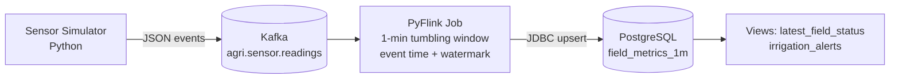

#  AgriStream_Realtime_Analytics_Pipeline

**A real-time agricultural analytics pipeline:** Apache Kafka for ingestion, PyFlink for windowed aggregation, and PostgreSQL for operational analytics, all containerized with Docker.

---

## Overview

AgriStream ingests a continuous stream of farm sensor readings (soil moisture, temperature, humidity, pH), computes **1-minute tumbling-window aggregates per field** using event time, and stores the results in PostgreSQL. Dashboards, APIs and alerting systems can then query it with plain SQL.



### Why this design

- **Kafka** decouples sensors from processing, absorbs bursts and lets you replay history.
- **Flink** uses event time and watermarks, so late or out-of-order packets from rural connectivity are handled correctly.
- **PostgreSQL** is indexed and queryable. The JDBC sink performs **upserts**, so restarts and replays never create duplicates.

---

## Quick Start

### Prerequisites

- Docker Engine 24+ and Docker Compose v2 (`docker compose version`)
- About 4 GB of free RAM
- Internet access on first build (connector JARs are downloaded from Maven Central)

You do **not** need to install Python, Java, Kafka or PostgreSQL locally. Everything runs in containers.

### Run it

```bash
# 1. Clone
git clone https://github.com/<your-username>/agristream.git
cd agristream

# 2. Configure (edit the password!)
cp .env.example .env

# 3. Build and start everything
docker compose up -d --build

# 4. Watch the Flink job get submitted
docker compose logs -f flink-submit
```

Open the Flink dashboard at **http://localhost:8081**. You should see a job named `agristream-1m-field-aggregation` in the **RUNNING** state.

> ⏱️ **Give it 1 to 2 minutes.** A full 1-minute window has to close, and the watermark trails real time by 5 seconds, before the first rows are written.

### Check the results

```bash
docker compose exec postgres psql -U agri -d agristream
```

```sql
-- Most recent windows
SELECT window_start, field_id, crop, reading_count,
       ROUND(avg_soil_moisture::numeric, 1) AS soil,
       ROUND(avg_temperature_c::numeric, 1) AS temp_c
FROM field_metrics_1m
ORDER BY window_start DESC, field_id
LIMIT 10;

-- Live status per field
SELECT * FROM latest_field_status;

-- Fields needing attention
SELECT * FROM irrigation_alerts;
```

With the default 10 events/s across 5 fields, expect about **120 readings per field per window**.

### Stop

```bash
docker compose down        # keep data
docker compose down -v     # wipe Kafka and PostgreSQL data
```

---

## Project Structure

```
agristream/
├── docker-compose.yml          # Orchestrates all services
├── .env.example                # Copy to .env
├── flink/
│   ├── Dockerfile              # Flink 1.18.1 + PyFlink + Kafka/JDBC/Postgres JARs
│   └── jobs/
│       └── agri_stream_job.py  # The streaming job (source, window, sink)
├── producer/
│   ├── Dockerfile
│   ├── requirements.txt        # confluent-kafka
│   └── producer.py             # Simulated farm sensors
└── postgres/
    └── init.sql                # Table, index and views (auto-run on first start)
```

## Services

| Service | Image | Purpose | Port |
|---|---|---|---|
| `kafka` | `apache/kafka:3.7.0` (KRaft) | Message broker | `29092` (host), `9092` (internal) |
| `kafka-init` | `apache/kafka:3.7.0` | Creates the topic (3 partitions), then exits | n/a |
| `postgres` | `postgres:16-alpine` | Analytics storage | `5432` |
| `jobmanager` | custom (`flink/Dockerfile`) | Flink coordinator and dashboard | `8081` |
| `taskmanager` | custom | Flink worker (2 slots) | n/a |
| `flink-submit` | custom | Submits the PyFlink job, then exits | n/a |
| `producer` | `python:3.11-slim` | Generates sensor events | n/a |

Startup order is handled by health checks: Kafka and Postgres become healthy, the topic is created, Flink starts, the job is submitted, and the producer starts.

---

## How It Works

### 1. Event format

Each sensor reading is a JSON message keyed by `field_id`, so a field's data stays ordered within one partition:

```json
{
  "sensor_id": "field-01-s2",
  "field_id": "field-01",
  "crop": "maize",
  "soil_moisture": 31.4,
  "temperature_c": 24.8,
  "humidity": 62.1,
  "ph": 6.4,
  "event_time": "2026-11-02T10:15:30.123"
}
```

`event_time` is UTC, ISO-8601, **without** a timezone suffix (required by Flink's `TIMESTAMP(3)` JSON parsing). About 5% of simulated events arrive up to 3 seconds late to exercise watermark handling.

### 2. Stream processing (`flink/jobs/agri_stream_job.py`)

The job defines three things with Flink SQL through the PyFlink Table API:

1. **Source:** a Kafka table with `WATERMARK FOR event_time AS event_time - INTERVAL '5' SECOND`.
2. **Sink:** a JDBC table pointing at `field_metrics_1m`, with `PRIMARY KEY (window_start, field_id) NOT ENFORCED`, which switches the connector to upsert mode.
3. **Query:** a `TUMBLE` window of 1 minute grouped by field, producing count, averages and max temperature.

Reliability settings in the job:

| Setting | Value | Why |
|---|---|---|
| `execution.checkpointing.interval` | 30 s | Fault tolerance with consistent Kafka offsets |
| `table.exec.source.idle-timeout` | 10 s | An empty partition cannot stall the watermark |
| `restart-strategy` | fixed-delay, 10 attempts | Automatic recovery from transient failures |

### 3. Storage (`postgres/init.sql`)

- `field_metrics_1m`: one row per field per minute.
- `latest_field_status`: view returning the newest window per field.
- `irrigation_alerts`: view flagging `LOW_SOIL_MOISTURE` (avg below 25) and `HEAT_STRESS` (max above 35 °C). Adjust thresholds in `init.sql`.

---

## Configuration

Edit `.env`, then run `docker compose up -d` to apply.

| Variable | Default | Description |
|---|---|---|
| `POSTGRES_USER` | `agri` | Database user |
| `POSTGRES_PASSWORD` | `change_me` | Database password. **Change it.** |
| `POSTGRES_DB` | `agristream` | Database name |
| `KAFKA_TOPIC` | `agri.sensor.readings` | Topic for sensor events |
| `EVENTS_PER_SECOND` | `10` | Simulator throughput |

Other useful knobs:

| What | Where |
|---|---|
| Window size | `INTERVAL '1' MINUTE` in `agri_stream_job.py` |
| Lateness tolerance | The `INTERVAL '5' SECOND` watermark delay |
| Number of fields and crops | `FIELDS` dict in `producer.py` |
| Flink parallelism and memory | `FLINK_PROPERTIES` in `docker-compose.yml` |

---

## Common Commands

| Task | Command |
|---|---|
| Tail all logs | `docker compose logs -f` |
| Check the producer | `docker compose logs -f producer` |
| Peek at raw Kafka messages | `docker compose exec kafka /opt/kafka/bin/kafka-console-consumer.sh --bootstrap-server kafka:9092 --topic agri.sensor.readings --max-messages 5` |
| Resubmit the job after editing it | Cancel it in the Flink UI, then `docker compose up -d flink-submit` |
| Add more Flink workers | `docker compose up -d --scale taskmanager=2` |
| Rebuild from scratch | `docker compose down -v && docker compose build --no-cache && docker compose up -d` |

Kafka is also reachable from your host at `localhost:29092` if you want to attach your own producers or consumers.

---

## Troubleshooting

| Symptom | Fix |
|---|---|
| Table is empty after 3+ minutes | Open http://localhost:8081. If the job is not RUNNING, check `docker compose logs flink-submit`. If it is running, confirm the producer is sending. |
| `Could not find any factory for identifier 'kafka'` | Connector JAR missing. Run `docker compose build --no-cache jobmanager`. |
| `python: command not found` in Flink logs | The `ln -sf /usr/bin/python3 /usr/bin/python` line is missing from `flink/Dockerfile`. |
| Job restarts repeatedly | Check the Exceptions tab in the Flink UI. Usually Postgres is unreachable or credentials differ from `.env`. |
| Some windows never appear | An idle partition is stalling the watermark. Keep `table.exec.source.idle-timeout` set. |
| Postgres rejects the password after editing `.env` | The volume keeps the old credentials. Run `docker compose down -v` and start again. |
| `port is already allocated` | Change the host side of the mapping, for example `5433:5432`. |
| Build fails downloading JARs | Check access to `repo.maven.apache.org`. |

---

## Production Hardening

This repo is a reproducible baseline. Before real farm traffic:

- **Kafka:** 3 brokers, replication factor 3, `min.insync.replicas=2`, TLS + SASL, explicit retention, consumer-lag monitoring.
- **Flink:** checkpoints on S3/GCS/HDFS (`state.checkpoints.dir`), RocksDB state backend, JobManager HA, savepoints before upgrades, dead-letter output for very late events.
- **PostgreSQL:** monthly partitioning, replication with PITR backups, a least-privilege user for Flink.
- **Security and operations:** secrets from a vault instead of `.env`, pinned and scanned images, Prometheus and Grafana, a schema registry (Avro or Protobuf).

## Contributing

Issues and pull requests are welcome. For larger changes, please open an issue first to discuss what you would like to change.

## License

This project is open-source and licensed under the terms of the [MIT LICENSE](MIT).
